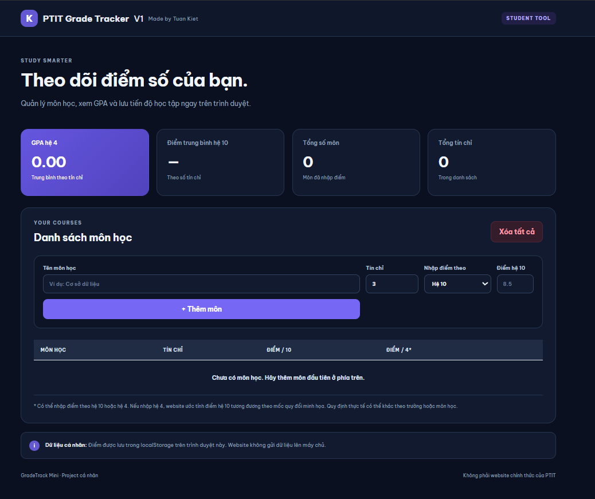

# 🎓 PTIT Grade Tracker

**A simple, responsive grade tracking web app for PTIT students.**

🔗 **[Live Demo](https://icyr4zo.github.io/PTIT-Grade-Tracker/)**

Track your academic performance, calculate your GPA, and manage your courses with a sleek dark mode interface.


## ✨ Features

- 📊 **GPA Calculator** — Calculate credit-weighted GPA on a 4.0 scale.
- 📝 **Grade Tracking** — Enter and manage course grades on either a 10-point or 4.0 scale.
- 🎯 **Weighted Average** — Calculate your average grade based on course credits.
- 📚 **Course Management** — Add courses, specify credits, and remove individual courses.
- 💾 **Local Data Storage** — Save your course information in your browser using `localStorage`.
- 🌙 **Dark Mode UI** — A modern dark interface designed for comfortable viewing.
- 📱 **Responsive Design** — Use the app on desktop and mobile devices.
- ⚡ **Lightweight & Fast** — Built with vanilla HTML, CSS, and JavaScript. No framework required.

## 🖥️ Preview

## 🖥️ Preview

<p align="center">
  
</p>

<p align="center">
  <i>Track your grades. Calculate your GPA. Stay on top of your studies.</i>
</p>

## 🛠️ Built With

| Technology | Purpose |
|---|---|
| 🌐 HTML5 | Page structure |
| 🎨 CSS3 | Styling, dark theme, and responsive layout |
| ⚙️ JavaScript | Grade calculations and course management |
| 💾 LocalStorage | Persisting data in the browser |
| 🚀 GitHub Pages | Free static website hosting |

## 🚀 Getting Started

### Run Locally

1. Clone the repository:

   ```bash
   git clone https://github.com/icyr4zo/ptit-grade-tracker.git
   ```

2. Open the project folder:

   ```bash
   cd ptit-grade-tracker
   ```

3. Open `index.html` in your browser.

That's it! No installation or build process is required.

### Deploy with GitHub Pages

1. Push the project files to your GitHub repository.
2. Open **Settings → Pages**.
3. Under **Build and deployment**, select **Deploy from a branch**.
4. Choose the `main` branch and the `/ (root)` folder.
5. Click **Save**.
6. Wait for deployment, then visit:

   `https://icyr4zo.github.io/ptit-grade-tracker/`

## 📖 How to Use

1. Enter the name of a course.
2. Specify the number of credits.
3. Choose the grading scale: **4.0** or **10-point**.
4. Enter your grade and click **+ Thêm môn**.
5. Review your GPA, weighted average, total courses, and total credits.
6. Remove individual courses or clear the list when needed.

## 📐 Grade Calculation

- **GPA (4.0 scale):** Calculated using course credits as weights.
- **Average grade (10-point scale):** Calculated using course credits as weights.
- **Grade conversion:** When a grade is entered on the 4.0 scale, the equivalent 10-point grade is estimated using illustrative conversion thresholds.

⚠️ Grade conversion is an estimate for reference only. Actual grading and conversion rules may vary by course or institution. Please consult the applicable PTIT regulations for official results.

## 🔒 Privacy

- Course data is stored locally in your browser using `localStorage`.
- The application does not send your grades to a backend server.
- Data is specific to the browser and device where it was entered.
- Clearing browser data may remove saved course information.

## 🗺️ Roadmap

Potential improvements for future versions:

- [ ] 📤 Export and import course data
- [ ] 📈 GPA progress visualization
- [ ] 🎨 Additional themes and interface customization
- [ ] 📱 Further mobile UI improvements

## 🤝 Contributing

Suggestions, bug reports, and improvements are welcome!

1. Fork this repository.
2. Create a feature branch.
3. Commit your changes.
4. Open a pull request.

## 👨‍💻 Author

**Tuan Kiet**

Made with ❤️ for students who want to keep track of their academic progress.

---

⭐ If you find this project useful, consider giving the repository a star!
